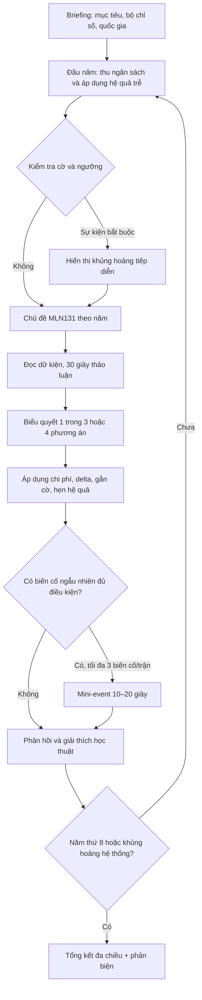

# GAME DESIGN DOCUMENT — THE TRANSITION: THỜI KỲ QUÁ ĐỘ

**Phiên bản:** 1.0 — tài liệu thiết kế có thể triển khai (không phải bản game)  
**Môn:** MLN131 — Chủ nghĩa xã hội khoa học  
**Thể loại:** Narrative strategy / nation governance / branching decision simulation  
**Đối tượng:** Sinh viên đại học; sử dụng khi thuyết trình, phản biện và thảo luận lớp  
**Thời lượng mục tiêu:** 12–15 phút, 8 lượt chính (8 năm mô phỏng), 0–3 sự kiện xen kẽ  
**Platform đề xuất:** Web offline, máy tính + máy chiếu; một người điều khiển, cả lớp bỏ phiếu  
**Tài liệu liên quan:** `02_Cay_tinh_huong_The_Transition_MLN131.md`

> **Tuyên bố phạm vi học thuật:** Quốc gia, nhân vật, thống kê, tình huống và hệ số tác động là **hư cấu dành cho mô phỏng**, không phải mô tả/đánh giá trực tiếp về Việt Nam hay kết quả thực nghiệm. Giáo trình là nguồn cho **khái niệm và logic lý luận**, không phải nguồn cho các con số mô phỏng. Các quan hệ nhân quả trong game là giả thuyết thiết kế cần kiểm thử. Không đồng nhất mục tiêu “duy trì chính phủ” với mục tiêu xây dựng chủ nghĩa xã hội.

---

## 1. Tầm nhìn trải nghiệm

### 1.1. Elevator pitch

Bạn là Hội đồng điều hành **Cộng hòa Hòa Minh**, một nhà nước giả định đang trong **thời kỳ quá độ lên chủ nghĩa xã hội**. Tám năm, tám quyết định chiến lược; tình hình thay đổi tùy theo quyết định cũ, trạng thái các nhóm xã hội và biến cố không đoán trước. Bạn phải phát triển lực lượng sản xuất, xử lý mâu thuẫn lợi ích, mở rộng phúc lợi, thực hành dân chủ, bảo đảm pháp quyền, đoàn kết dân tộc, tự do tín ngưỡng và điều kiện phát triển của gia đình — với ngân sách và năng lực quản trị hữu hạn.

**Câu hỏi trung tâm:** Làm thế nào theo đuổi mục tiêu xã hội chủ nghĩa trong điều kiện phát triển không đồng đều, nguồn lực giới hạn và lợi ích xã hội đa dạng?

### 1.2. Ba trụ cột thiết kế

1. **Trade-off có căn cứ:** Không có lựa chọn “thiện tuyệt đối” không mất gì. Cần cân nhắc lợi ích dài hạn, nhóm được/nhóm chịu chi phí, năng lực thực thi.
2. **Chính sách có trí nhớ:** Quyết định năm 1 thay đổi điều kiện và lựa chọn ở năm 3, 5, 8; game nhớ nợ chính sách, niềm tin, cải cách thiết chế.
3. **Giải thích sau hệ quả:** Người chơi được học qua phản hồi và phần debrief có đối chiếu chính xác nội dung giáo trình; tuyệt đối không dùng điểm số thay cho lập luận lý luận.

### 1.3. Tiêu chí thành công học tập

Người học phải: (a) phân biệt lực lượng sản xuất / quan hệ sản xuất; (b) lý giải vị trí, lợi ích, tổ chức của giai cấp công nhân; (c) nhận biết đặc trưng và khó khăn thời kỳ quá độ; (d) vận dụng dân chủ xã hội chủ nghĩa và nhà nước pháp quyền xã hội chủ nghĩa; (e) phân tích liên minh và biến đổi cơ cấu giai cấp; (f) phân biệt bình đẳng dân tộc / đoàn kết / tự quyết trong bối cảnh chính trị-pháp lý; (g) xử lý tình huống tôn giáo tôn trọng tự do tín ngưỡng; (h) liên hệ vai trò gia đình và chính sách xã hội.

**Đánh giá:** 50% chất lượng lập luận khi chọn, 30% dự báo hệ quả và phản biện, 20% kiến thức liên hệ; **không chấm học thuật chỉ bằng kết cục game**.

---

## 2. Bối cảnh thế giới và giả định

### 2.1. Cộng hòa Hòa Minh (hoàn toàn hư cấu)

- Dân số: 22 triệu; 60% đô thị, 40% nông thôn; nhiều cộng đồng dân tộc và tín ngưỡng.
- Nền kinh tế: nông nghiệp chuyển sang công nghiệp và dịch vụ số; có khu vực nhà nước, tập thể, tư nhân và đầu tư nước ngoài.
- Mục tiêu hiến định trong hư cấu: phát triển lực lượng sản xuất gắn với tiến bộ, công bằng xã hội; nhà nước pháp quyền xã hội chủ nghĩa; phát huy vai trò của nhân dân.
- Cơ cấu điều hành: Hội đồng điều hành (người chơi), cơ quan dân cử, cơ quan hành chính, cơ quan tư pháp, chính quyền địa phương, tổ chức đại diện người lao động, tổ chức xã hội. Mô phỏng **không cho người chơi quyền đứng trên pháp luật**.
- Thời gian: 8 năm; mỗi lượt gộp chu trình đề xuất → thẩm định → tham vấn → tổ chức thực thi → đánh giá. Không coi một cú nhấp là đủ thay đổi toàn xã hội.

### 2.2. Các nhóm liên quan (stakeholder simulation)

| Nhóm | Mối quan tâm thực tế | Mâu thuẫn khả dĩ |
|---|---|---|
| Công nhân công nghiệp | Lương thực tế, an toàn, đại diện, kỹ năng | Lợi nhuận ngắn hạn / tự động hóa |
| Nông dân, hợp tác xã | Đất đai, đầu ra, tín dụng, hạ tầng | Đô thị hóa / mất sinh kế |
| Lao động nền tảng | Bảo hiểm, hợp đồng, tính linh hoạt | Chi phí nền tảng / bảo đảm quyền lợi |
| Trí thức, kỹ sư | Giáo dục, nghiên cứu, cơ hội sáng tạo | Đầu tư dài hạn / ngân sách hiện tại |
| Doanh nghiệp tư nhân | Quy tắc ổn định, vốn, năng suất | Chi phí tuân thủ / phúc lợi |
| Cộng đồng dân tộc thiểu số | Tiếng nói, hạ tầng, văn hóa, cơ hội | Phân bổ nguồn lực không đồng đều |
| Cộng đồng tín ngưỡng / không tín ngưỡng | Bình đẳng, tự do, xử lý công bằng | Lạm dụng quyền lực / lợi dụng tôn giáo |
| Gia đình | Nhà ở, việc làm, chăm sóc trẻ, người già | Căng thẳng việc–nhà; khác biệt vùng miền |

Các nhóm không phải “đối thủ”; bất đồng hợp pháp và phê bình chính sách không tự động là dấu hiệu phá hoại.

---

## 3. Bộ máy chỉ số và tài nguyên

### 3.1. Chỉ số hiển thị, thang 0–100

| Key | Chỉ số | Khởi điểm | Ý nghĩa gameplay |
|---|---|---:|---|
| `PROD` | Năng lực sản xuất | 52 | Năng suất, công nghệ, năng lực tạo của cải |
| `LIFE` | Đời sống & an sinh | 48 | Thu nhập thực, dịch vụ thiết yếu, phúc lợi |
| `TRUST` | Niềm tin & tham gia | 54 | Mức tin cậy, khả năng tham gia và giám sát |
| `LAW` | Pháp quyền & liêm chính | 51 | Thực thi luật, trách nhiệm giải trình, kiểm soát quyền lực |
| `EQUITY` | Công bằng cơ hội | 45 | Khoảng cách vùng, nhóm, khả năng tiếp cận |
| `COHESION` | Đoàn kết & ổn định xã hội | 57 | Năng lực giải quyết xung đột không bạo lực |

**Tài nguyên riêng:** `BUDGET=60` (đơn vị nguồn lực giả định, không phải tỷ đồng); `CAPACITY=50` (năng lực triển khai hành chính 0–100); `DEBT=0` (áp lực tài khóa tích lũy 0–100); `YEAR=1`.

**Cân bằng:** Các chỉ số bắt đầu trung bình để cho phép cả thành tựu lẫn thất bại. Chênh lệch ở cuối năm có ý nghĩa hơn giá trị đơn lẻ. Các điểm có thể điều chỉnh qua playtest.

### 3.2. Vận hành ngân sách

- Mỗi năm thu cơ sở `+12 BUDGET`; cộng thêm `floor((PROD-50)/15)` và trừ `ceil(DEBT/25)`; giới hạn thu ròng tối thiểu `+5`.
- Mỗi lựa chọn có `budget_cost`, có thể âm nếu tăng thu/tiết kiệm; **không được chọn** nếu số dư sau tính chi phí < `-10`.
- Nếu `BUDGET<0`: cộng `DEBT += abs(BUDGET)*2` ở cuối lượt; phạt `TRUST -2` và `LIFE -2` nếu âm ngân sách 2 năm liên tiếp.
- `CAPACITY<35` làm giảm 40% (làm tròn về 0) *mọi tác động dương* của chính sách phức tạp; tác động tiêu cực giữ nguyên. Quyết định có cơ chế thiết kế/quản trị tốt có thể tăng `CAPACITY`.
- Điểm hạ tầng và đào tạo tác động có độ trễ: biến `pending_effects` áp dụng ở lượt sau.

### 3.3. Chống 'game hóa' sai học thuật

- Các điểm **không đo lường chính trị thực tế**; chúng là công cụ quan sát trade-off.
- Không quy đồng “ổn định” = “cấm phản biện”. Kiểm soát thông tin tùy tiện có thể tạo ổn định bề mặt ngắn hạn nhưng giảm `LAW/TRUST` và tăng `latent_discontent`.
- Không thưởng việc kỳ thị nhóm dân tộc, tôn giáo, giới; hành vi phân biệt đối xử gây thiệt hại quyền, giảm pháp quyền và đoàn kết.
- Không coi tăng trưởng đơn độc là thắng; cũng không coi phân phối khi không có nền tảng sản xuất là tự bền vững.
- Không có mô hình chính trị nào được “chứng minh” bằng trò chơi; cần phân biệt lập luận từ giáo trình với thiết kế hệ quả mô phỏng.

---

## 4. Cấu trúc phiên chơi 12–15 phút



**8 mốc bắt buộc:** Năm 1 công nhân → 2 chuyển đổi mô hình → 3 dân chủ → 4 pháp quyền → 5 liên minh và cơ cấu giai cấp → 6 dân tộc → 7 tôn giáo → 8 gia đình. Mỗi mốc có một **tình huống gốc luôn xuất hiện**, nhưng nội dung và phương án được điều chỉnh theo cờ trước đó. 0–3 biến cố xen kẽ được rút có điều kiện để replayable; tránh 8 sự kiện chính bị thay thế ngẫu nhiên khiến mất chương học.

### 4.1. Thời gian trên lớp

- 1 phút giới thiệu bối cảnh, luật.
- 8 × ~65 giây = 8 phút 40 giây: đọc (20s), tranh luận và bỏ phiếu (30s), kết quả (15s).
- 0–3 sự kiện xen kẽ × 20–30 giây.
- 2–3 phút debrief, so sánh lập luận, liên hệ giáo trình.

### 4.2. Format thẻ tình huống

`Mã` / `Năm-chương` / `Bản tin (động)` / `Dữ kiện kiểm chứng được trong thế giới game` / `Mâu thuẫn` / `3 lựa chọn khả thi` / `Thông tin thiếu hoặc dự báo bất định` / `Hệ quả tức thì` / `Hệ quả trễ` / `Cờ kế thừa` / `Gợi mở lý luận` / `Câu hỏi phản biện`.

**Quan trọng:** Cho chọn trước khi tiết lộ điểm. Khi kết thúc, hiển thị nhóm hưởng lợi–chịu tác động và nguyên nhân; không đánh dấu “A/B/C đúng” ở UI.

---

## 5. Kiến trúc quyết định và nhớ nhánh

### 5.1. State schema để lập trình

```yaml
state:
  year: 1
  metrics: { PROD: 52, LIFE: 48, TRUST: 54, LAW: 51, EQUITY: 45, COHESION: 57 }
  resources: { BUDGET: 60, CAPACITY: 50, DEBT: 0 }
  flags: []
  counters: { latent_discontent: 0, consecutive_budget_deficit: 0, random_events_seen: 0 }
  pending_effects: []
  history: []
  random_seed: 2026
```

`flags` là những biến nhị phân hoặc nhãn: `LABOR_DIALOGUE`, `WAGE_SHOCK`, `AUTOMATION_SKILLS`, `ECON_BALANCED`, `ECON_OVERHEAT`, `CONSULT_REAL`, `CONSULT_TOKEN`, `ANTI_CORRUPTION_INDEPENDENT`, `ENFORCEMENT_SELECTIVE`, `COALITION_BUILT`, `REGION_PARTICIPATION`, `RELIGION_FAIR_PROCESS`, `CARE_INFRASTRUCTURE`, `WELFARE_UNFUNDED`.

### 5.2. Quy tắc về nhánh

- **Trong cùng lượt:** Một tình huống gốc có biến thể `variant` theo flags: ví dụ Y1 đối thoại → Y5 ứng phó lao động nền tảng có sẵn kênh thương lượng.
- **Hệ quả trễ:** Y2 đầu tư đào tạo → Y5 năng suất +7; Y4 cải cách công khai → Y6 niềm tin của cộng đồng tăng.
- **Chuỗi khủng hoảng:** Y1 ép đình công + Y3 tham vấn hình thức → mini-event `R01` ở Y4/Y5; nếu tiếp tục không xử lý → Y8 điểm kết thúc xấu hơn.
- **Đường sửa sai:** Một quyết định chưa tốt **không khóa** chiến thắng. Người chơi có thể trả chi phí sửa và thay đổi cờ, nhưng thường mất thời gian/ngân sách.
- **Lựa chọn có điều kiện:** Chỉ mở “chính sách toàn diện” nếu `CAPACITY>=45` hoặc đã có cờ chuẩn bị; nếu không, cho phương án thí điểm thay vì giấu mất giải pháp.

### 5.3. Công thức thực thi (pseudo-code)

```text
start_year:
    apply(pending_effects due <= year)
    BUDGET += max(5, 12 + floor((PROD - 50)/15) - ceil(DEBT/25))
    if BUDGET < 0 for 2 consecutive years: LIFE -= 2; TRUST -= 2

present_main_event(year, variant = resolve(flags, thresholds))
choice = class_vote()
if not affordable(choice): offer fallback "thí điểm/phân kỳ" (không game over tức thì)
apply(choice.immediate_effects * implementation_rule)
BUDGET -= choice.budget_cost
set_flags_and_schedule(choice)

if random_events_seen < 3 and random_event_eligible:
    roll seeded chance (do not reroll on UI refresh)
    resolve_one_event()

clamp(metrics, 0, 100); clamp(CAPACITY, 0, 100)
check_critical_state()
advance_year_or_end()
```

---

## 6. Cơ chế biến cố ngẫu nhiên

**Không ngẫu nhiên vô điều kiện:** Mỗi biến cố có `eligible_years`, `preconditions`, `weight`, `cooldown`, `exclusion_tags`, `consequences`. Trong 8 lượt tối đa 3 mini-event; bảo đảm tối thiểu 5 lượt tập trung chủ đề, không quá tải buổi thuyết trình.

| Event | Cần điều kiện | Trọng số | Bài học |
|---|---|---:|---|
| R01 Đình công lan rộng | `latent_discontent>=2` hoặc `WAGE_SHOCK` | 5 | Đại diện và đối thoại trong quan hệ lao động |
| R02 Sốc đơn hàng xuất khẩu | Năm 2–6 | 3 | Phụ thuộc thị trường, phát triển lực lượng sản xuất |
| R03 Lộ dữ liệu tham vấn giả | `CONSULT_TOKEN` | 6 | Dân chủ thực chất khác thủ tục hình thức |
| R04 Kiểm toán phát hiện thất thoát | Năm 3–7; tăng nếu `LAW<45` | 5 | Kiểm soát quyền lực, thực thi pháp luật |
| R05 Hạn kéo dài vùng cao | Năm 5–7 | 3 | Công bằng phát triển giữa các vùng |
| R06 Tin giả kích động bất hòa | Năm 6–8, đặc biệt khi `TRUST<45` | 3 | Phân biệt thông tin sai với ý kiến phê bình hợp pháp |
| R07 Cơ sở tín ngưỡng xin đăng ký hoạt động | Năm 6–8 | 2 | Tự do tín ngưỡng và xử lý hành chính công bằng |
| R08 Cú sốc sinh kế gia đình | Năm 7–8; tăng nếu `LIFE<45` | 4 | Vai trò kinh tế, tái sản xuất con người của gia đình |

**Rút mẫu:** bỏ sự kiện không đủ điều kiện; loại sự kiện cùng `tag` trong 2 năm liên tiếp; ưu tiên sự kiện minh họa hậu quả cờ trước; nếu không có sự kiện hợp lệ thì bỏ qua. Random seed cố định theo phiên để có thể audit và chạy lại.

---

## 7. Hệ thống kết thúc

### 7.1. Kết thúc sớm (hiếm, có cơ hội cứu vãn)

- **Khủng hoảng thể chế:** `LAW<=15` **và** `TRUST<=15` kéo dài hai năm → cho một **nút phục hồi cuối** với đánh đổi lớn; nếu thất bại → kết cục đứt gãy năng lực quản trị.
- **Khủng hoảng sinh kế:** `LIFE<=12` **và** `PROD<=15` kéo dài hai năm → cơ chế cứu trợ, tái cấu trúc; nếu không khắc phục → sụp đổ năng lực cung ứng.
- Không bao giờ dùng `COHESION` thấp đơn độc để quyết định “sụp đổ”; tránh gán đồng nhất phản biện với bất ổn.

### 7.2. Kết thúc ở năm 8

1. **Chuyển đổi có nền tảng:** 6/6 chỉ số >=55, `LAW>=60`, `LIFE>=55`, `DEBT<60`; tiến bộ đồng thời kinh tế–xã hội–thể chế.
2. **Tăng trưởng lệch pha:** `PROD>=65` nhưng `EQUITY<40` hoặc `LIFE<45`; phát triển lực lượng sản xuất nhưng lợi ích phân bố không tương xứng.
3. **Phúc lợi thiếu bền vững:** `LIFE>=55`, `PROD<40` hoặc `DEBT>=75`; nguồn lực hạn chế đe dọa thành quả.
4. **Ổn định hình thức:** `COHESION>=55` nhưng `LAW<35` hoặc `TRUST<35`; hệ quả của thiếu minh bạch và đại diện.
5. **Cải cách dang dở:** Trường hợp còn lại; xác định 2 tiến bộ và 2 thách thức.
6. **Đứt gãy quản trị:** Điều kiện khủng hoảng sớm không vượt qua nút phục hồi.

**Ưu tiên phân loại:** Đứt gãy → Tăng trưởng lệch pha → Phúc lợi thiếu bền vững → Ổn định hình thức → Chuyển đổi có nền tảng → Cải cách dang dở. Nếu thỏa nhiều, hiển thị kết quả chính + chú giải phụ, không xóa nghịch lý.

**Report cuối:** biểu đồ 6 chỉ số, 3 quyết định bước ngoặt, 2 hệ quả trễ, quyền lợi 3 nhóm liên quan, câu hỏi “Nếu chọn khác ở Y3, Y6 thì sao?”, nguồn kiến thức theo chương.

---

## 8. UX / Information architecture

```text
START / Giới thiệu (45s)
  → DASHBOARD (6 thanh chỉ số + ngân sách + năm + 1 dòng cảnh báo)
    → EVENT CARD (bản tin + 2–3 dữ kiện + nhân vật liên quan)
      → POLICY CHOICE (3 lựa chọn; có lời giải thích ngắn; không hiện delta)
        → CONSEQUENCE (tác động hiện tại + hẹn năm + nhóm tác động)
          → ACADEMIC LENS (lý luận thuộc chương, 1 câu hỏi tranh luận)
            → NEXT YEAR
  → FINAL REPORT (đồ thị + kết cục + bàn luận)
```

**Phong cách:** bảng điều hành dễ đọc trên màn chiếu; màu trung tính; các nhóm xã hội biểu đạt bằng icon đơn giản không định kiến; không sử dụng biểu tượng/lãnh đạo/quốc kỳ thật để tránh nhầm lẫn với mô phỏng nhà nước có thật. Có chế độ Presenter ẩn điểm trước khi chọn, nút bỏ qua hoạt ảnh, phím tắt 1/2/3, phím Undo chỉ trong buổi thử nghiệm (khi chơi chính thức không undo), lưu seed và lịch sử để so sánh hai lớp.

## 9. Chế độ học tập và phản biện

- **Sau mỗi tình huống:** (1) người chọn bảo vệ quan điểm 15 giây; (2) một nhóm chỉ ra chi phí cơ hội; (3) hiện kết quả; (4) giảng viên liên hệ chương.
- **Hộp kiến thức:** đặt tên khái niệm giáo trình; phân biệt nội dung mô tả học thuyết với suy luận thực hành.
- **Câu hỏi mở:** “Ai được lợi? Ai chịu chi phí? Có giải pháp thay thế trong giới hạn ngân sách? Nếu năng lực thực thi thấp thì sao?”
- **Không ép trả lời theo một khẩu hiệu:** các phương án cần cho thấy sự khác biệt giữa **mục tiêu**, **biện pháp**, **trình tự thực hiện** và **kết quả thực tế**.

## 10. Ma trận truy vết MLN131

| Mốc | Kiến thức / mục tiêu | Giáo trình tham chiếu | Cơ chế thực hiện |
|---|---|---|---|
| Y1 | Sứ mệnh lịch sử, điều kiện khách quan/chủ quan của GCCN | Ch.2, đặc biệt mục sứ mệnh lịch sử (trang in khoảng 51–71) | lao động, công đoàn, nâng kỹ năng |
| Y2 | CNXH và thời kỳ quá độ; phát triển lực lượng sản xuất | Ch.3 | cải cách kinh tế theo lộ trình |
| Y3 | Dân chủ XHCN, bản chất và thực hành | Ch.4 | tham vấn, giám sát, phản hồi chính sách |
| Y4 | Nhà nước XHCN, nhà nước pháp quyền XHCN | Ch.4 (kiểm tra mục lục của bản giáo trình) | kiểm soát quyền lực, chống tham nhũng |
| Y5 | Cơ cấu xã hội–giai cấp; liên minh giai cấp và tầng lớp | Ch.5 | phối hợp phân phối nguồn lực cho các nhóm |
| Y6 | Dân tộc trong thời kỳ quá độ | Ch.6 | bình đẳng, đoàn kết, cơ hội, tiếng nói cộng đồng |
| Y7 | Tôn giáo trong thời kỳ quá độ | Ch.6 | tự do tín ngưỡng, tách hành vi vi phạm khỏi niềm tin |
| Y8 | Gia đình trong thời kỳ quá độ | Ch.7 | chăm sóc, bình đẳng, an sinh, biến đổi gia đình |

**Chú thích quan trọng về phân chương:** File lịch trình lớp đặt nội dung “nhà nước pháp quyền” ở **Chương 5** theo cách tổ chức buổi học; trong cấu trúc giáo trình CNXHKH 2021, nội dung dân chủ XHCN và nhà nước XHCN thường được trình bày cùng **Chương 4**, còn cơ cấu xã hội–giai cấp thuộc **Chương 5**. Khi lên slide nên ghi cả *chủ đề lớp* lẫn *chương giáo trình* để tránh sai quy chiếu. Mốc trang ở đây chỉ là hướng dẫn tìm, không phải trích dẫn nguyên văn.

## 11. Nguồn và mức độ chứng thực

1. **Bộ Giáo dục và Đào tạo (2021), _Giáo trình Chủ nghĩa xã hội khoa học_ (dành cho bậc đại học hệ không chuyên lý luận chính trị), NXB Chính trị quốc gia Sự thật.** Bản PDF do người dùng cung cấp: ảnh scan; xác nhận bìa, bản quyền và nội dung Chương 1–2; chương và nhánh khác được bám theo cấu trúc đề mục môn học và cần đối chiếu trang chi tiết khi biên tập cuối.
2. **MLN131, “Lịch trình làm việc và các chủ đề thảo luận”, Fall 2026, FPT University Hanoi.** 8 chủ đề thảo luận của lớp được dùng làm khung tình huống.
3. **Mô hình chơi, số điểm, quốc gia Hòa Minh, kịch bản, phát biểu nhân vật:** do nhóm thiết kế sáng tạo, **không** phải trích dẫn giáo trình, không phải diễn giải kết quả thực tế.

---

## 12. Tiêu chí nghiệm thu và backlog

**Must-have (để có prototype trình chiếu):** 8 tình huống gốc, 24 lựa chọn, min 6 chỉ số, ngân sách, 10+ cờ, ít nhất 8 nhánh kế thừa, 8 biến cố điều kiện, 6 kết cục, report cuối, presenter mode, nguồn theo chương.

**Should-have:** nhánh cứu vãn, nhóm liên quan hiển thị, biểu đồ thay đổi theo năm, các câu hỏi phản biện, seed tái lập.

**Could-have:** sự kiện tự viết của giảng viên, 2 đội thi đấu cùng seed, xuất report CSV, dự đoán kết quả trước khi chọn.

**Kiểm thử bắt buộc:**
- 1 phiên thiên về tăng trưởng; 1 thiên về trợ cấp; 1 thiên về kiểm soát; 1 cân bằng; 1 cố ý đi vào khủng hoảng.
- Mỗi lựa chọn đều khả thi hoặc có biến thể phù hợp ngân sách.
- Phương án làm tăng chỉ số ngắn hạn có thể tạo hậu quả trễ hợp lý; không có “đúng mặc định” luôn + điểm.
- Không có random event phá vòng 8 chủ đề; mỗi sự kiện chỉ kích hoạt tối đa 1 lần/phiên.
- Hiệu ứng tăng năng suất/lợi ích vùng không ghi “theo giáo trình”; đây là giả định hệ thống.
- Kiểm tra quyền con người, tự do tín ngưỡng, quyền các cộng đồng và cách trình bày xung đột theo cách không định kiến.
