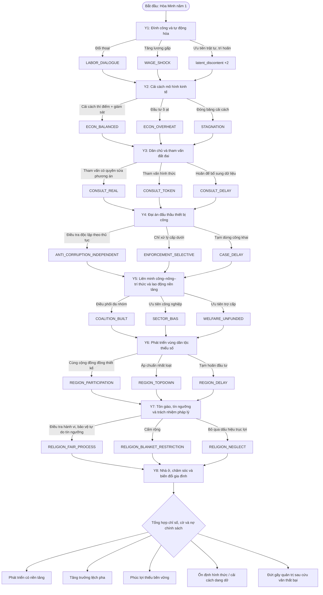
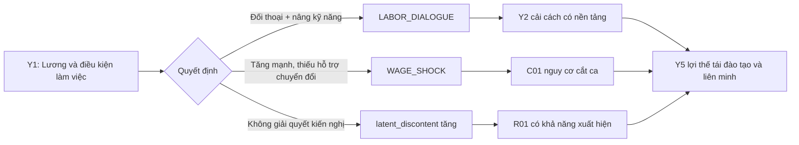
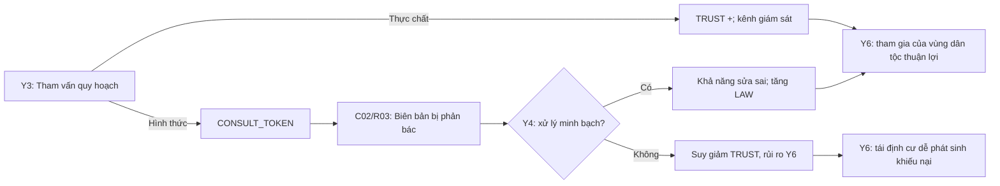
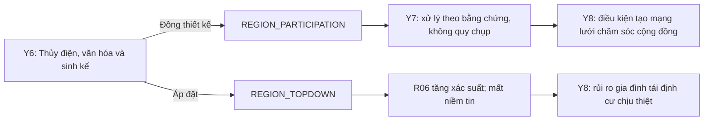

# THE TRANSITION — CÂY SỰ KIỆN, TÌNH HUỐNG VÀ NHÁNH QUYẾT ĐỊNH

**Phiên bản:** 1.0 · **Dùng cùng:** `01_GDD_The_Transition_MLN131.md`  
**Mục đích:** Kịch bản đủ cụ thể cho người viết game tạo event engine, đủ sâu cho sinh viên thảo luận/đối chiếu giáo trình MLN131.  
**Quy ước:** Tất cả địa danh, số liệu, nhân vật là giả định. `Δ` là thay đổi chỉ số game, không phải kết quả đo lường thực tế. Câu văn “giáo trình” chỉ gán cho khái niệm có căn cứ, không gán cho giả định tác động điểm.

## 0. Mã hóa và cách đọc

| Ký hiệu | Nghĩa |
|---|---|
| `Y1`–`Y8` | 8 tình huống xương sống, bắt buộc theo năm |
| `R01`–`R08` | Biến cố ngẫu nhiên có điều kiện, tối đa 3/phần chơi |
| `C01`–`C05` | Tình huống hậu quả nối dài hoặc cơ hội sửa sai; xuất hiện khi đủ điều kiện, có thể dùng làm biến thể của lượt chính |
| `O-A/B/C` | Phương án quyết định; không có đáp án tuyệt đối đúng |
| `now` | Hệ quả ngay sau khi chọn |
| `due:Yx` | Hệ quả sẽ kích hoạt ở năm x, có thể chịu điều kiện khác |
| `flag+` | Gắn cờ trạng thái để phân nhánh |
| `cost` | Tiêu ngân sách (`-` là thu thêm/tiết kiệm) |
| `metric` | `PROD`, `LIFE`, `TRUST`, `LAW`, `EQUITY`, `COHESION` |
| `cap` | Thay đổi `CAPACITY`; `debt` thay đổi `DEBT` |
| `repair` | Nút sửa sai trả giá; không coi lựa chọn ban đầu là định mệnh |

**Thứ tự xử lý trong mỗi năm:** nhận hệ quả trễ → thêm ngân sách → resolve biến thể sự kiện chính → chọn → cập nhật cờ → có thể bốc mini-event → kiểm tra nguy cơ → sang năm. Nếu đồng thời có cả `Cxx` và `Rxx`, ưu tiên `Cxx` (hệ quả của quyết định trước quan trọng hơn ngẫu nhiên).

## 1. Sơ đồ cây tổng thể



**Lưu ý thiết kế:** Sơ đồ trên thể hiện cờ chủ đạo, **không** tách thành `3^8 = 6.561` cốt truyện viết tay. Engine giữ trạng thái + biến thể động để tạo cây có ý nghĩa mà vẫn quản lý được nội dung.

---

# 2. EIGHT MANDATORY EVENT NODES

## Y1 — “Khu công nghiệp Thiên Hà ngừng máy”

**Chủ đề môn:** Chương 2 — giai cấp công nhân, sứ mệnh lịch sử, điều kiện và tổ chức thực hiện.  
**Bối cảnh:** 18.000 người làm trong khu công nghiệp Thiên Hà. Đơn hàng điện tử giảm 12% (số giả định), lương thực tế bị bào mòn, ca làm kéo dài. Hơn 4.000 người ngừng việc. Doanh nghiệp đề nghị tự động hóa 30% dây chuyền và yêu cầu ưu đãi thuế để giữ đơn hàng. Tổ chức đại diện người lao động phản ánh thỏa ước tập thể không được thực hiện đầy đủ.

**Thông tin màn hình:** Mức lương chưa đáp ứng chi phí thuê nhà; đơn hàng đang giảm; đa số người lao động muốn thương lượng chứ không muốn đóng nhà máy. **Mâu thuẫn:** bảo vệ quyền lợi, đại diện của công nhân ↔ duy trì năng lực sản xuất ↔ khả năng cạnh tranh.

| ID | Chính sách | now / cost | due / cờ | Tranh luận cần có |
|---|---|---|---|---|
| Y1-A | Lập cơ chế thương lượng ba bên, tăng lương theo 2 kỳ, kiểm tra an toàn lao động và quỹ nâng kỹ năng | `LIFE+5 TRUST+7 LAW+3 COHESION+6 PROD-2; cost=8; cap+3` | `flag+ LABOR_DIALOGUE`; Y3: `TRUST+3` nếu không phát sinh R01; Y5 mở nâng kỹ năng cho lao động nền tảng | Thương lượng có đủ nhanh không? Cơ chế đại diện thực chất là gì? |
| Y1-B | Tăng lương bắt buộc 18% ngay, trợ cấp doanh nghiệp 1 năm nhưng thiếu phương án đào tạo lại | `LIFE+9 TRUST+4 COHESION+3 PROD-7; cost=13` | `flag+ WAGE_SHOCK`; Y2 nếu `PROD<50`: `PROD-4 BUDGET-3`; Y5 có nguy cơ thất nghiệp do tự động hóa | Đáp ứng nhu cầu trước mắt có làm suy giảm việc làm dài hạn? |
| Y1-C | Không can thiệp vào lương, yêu cầu khôi phục sản xuất ngay, hứa xem xét kiến nghị trong 12 tháng | `PROD+3 LIFE-7 TRUST-10 LAW-3 COHESION-7; cost=1` | `latent_discontent+2`; Y3 nếu không `CONSULT_REAL` → R01 hợp lệ với trọng số cao | “Trật tự” có đồng nghĩa giải quyết mâu thuẫn lao động? |

**Biến thể:** Nếu `CAPACITY<40`, Y1-A chỉ tăng `TRUST+4`, trừ khi cấp thêm `cost=3` để nâng năng lực hòa giải.  
**Bài học:** Phân biệt vị trí kinh tế–xã hội của giai cấp công nhân với điều kiện chủ quan để thực hiện vai trò của giai cấp (tổ chức, ý thức, đại diện). Phát triển công nghiệp không đồng nghĩa tự động bảo đảm quyền lợi lao động.  
**Debrief:** “Sứ mệnh lịch sử” có thể hiện ra sao trong việc tổ chức, năng lực công nghệ và quan hệ với các tầng lớp khác, thay vì chỉ bằng biểu tượng hay khẩu hiệu?

## Y2 — “Tăng trưởng nhanh hay chuyển đổi có kiểm soát?”

**Chủ đề:** Chương 3 — CNXH và thời kỳ quá độ; đặc điểm chuyển đổi, phát triển lực lượng sản xuất và tổ chức kinh tế.  
**Bối cảnh:** Tổ hợp chế tạo công nghệ cao đề nghị ưu đãi thuế 10 năm đổi lấy 65.000 việc làm dự kiến. Đồng thời, các hợp tác xã muốn vốn số hóa bảo quản, truy xuất nông sản; cơ quan kế hoạch cảnh báo tiến độ giải ngân thấp, kiểm toán chưa theo kịp quy mô đầu tư. **Dữ kiện bị bỏ ngỏ:** dự báo thị trường có độ bất định lớn.

| ID | Chính sách | now / cost | due / cờ | Tranh luận |
|---|---|---|---|---|
| Y2-A | Chia 2 giai đoạn: thử nghiệm vùng công nghiệp, đầu tư đào tạo, hợp tác xã, cạnh tranh minh bạch và kiểm toán hằng năm | `PROD+4 LIFE+2 LAW+3 EQUITY+4 TRUST+2; cost=12; cap+4` | `ECON_BALANCED, AUTOMATION_SKILLS`; due:Y5 `PROD+7 LIFE+3` nếu `CAPACITY>=40` | Vì sao lựa chọn lộ trình có thể tốt hơn tối đa tăng trưởng ngay? |
| Y2-B | Phê duyệt toàn bộ đặc khu và ưu đãi lớn để hút vốn nhanh, bỏ qua thiết kế đào tạo vùng nông thôn | `PROD+11 LIFE+2 EQUITY-7 LAW-4; cost=18; debt+8` | `ECON_OVERHEAT`; due:Y4 nếu `LAW<55` → `LAW-5 TRUST-3`, tăng xác suất R04; Y5 `PROD+3`, `EQUITY-3` | Chi phí cơ hội và rủi ro của tăng trưởng tập trung? |
| Y2-C | Đóng băng cải cách, cấp trợ giá đại trà nhằm giữ mức sống, hoãn công nghệ mới | `LIFE+7 TRUST+2 PROD-7; cost=15; debt+10` | `STAGNATION, WELFARE_UNFUNDED`; due:Y5 `PROD-6`, trừ phi có sửa sai | Phân phối có thể bền vững khi không mở rộng năng lực tạo của cải? |

**Biến thể:** Nếu `WAGE_SHOCK`, chi phí Y2-B cộng 4; nếu `LABOR_DIALOGUE`, Y2-A nhận thêm `TRUST+2`.  
**Bài học:** Thời kỳ quá độ là tiến trình có những mâu thuẫn và nhiệm vụ phát triển; cần phân biệt mục tiêu xã hội chủ nghĩa với công cụ, trình tự và năng lực tổ chức thực hiện.  
**Debrief:** Một chính sách thúc đẩy thị trường có thể cùng tồn tại với định hướng xã hội chủ nghĩa trong điều kiện gì?

## Y3 — “Đường vành đai đi qua 6 xã”

**Chủ đề:** Chương 4 — dân chủ xã hội chủ nghĩa, tham gia, giám sát và quyền làm chủ.  
**Bối cảnh:** Dự án đường vành đai giúp rút thời gian vận tải nhưng ảnh hưởng 2.300 hộ, gồm nông dân và cư dân lâu năm. Hồ sơ quy hoạch công bố muộn; hai phương án tuyến có chi phí khác nhau. Ủy ban địa phương đề nghị duyệt gấp để kịp ngân sách. Nhóm cư dân trình phương án giảm tái định cư và yêu cầu phản hồi chính thức. **Mâu thuẫn:** năng lực quyết định nhanh ↔ quyền tham gia thực chất ↔ chi phí dự án.

| ID | Chính sách | now / cost | due / cờ | Tranh luận |
|---|---|---|---|---|
| Y3-A | Công bố dữ liệu, mở tham vấn có biên bản, điều chỉnh tuyến theo tiêu chí minh bạch, có cơ chế khiếu nại độc lập | `TRUST+9 LAW+6 EQUITY+4 PROD-2; cost=8; cap+2` | `CONSULT_REAL`; due:Y4 `TRUST+2`; due:Y6 `COHESION+3` nếu không kỳ thị vùng | Tham vấn chỉ là hỏi ý kiến hay phải chứng minh ý kiến đã được xem xét? |
| Y3-B | Tổ chức cuộc họp công khai ngắn, giữ nguyên tuyến đã duyệt, công bố rằng người dân đã đồng thuận | `PROD+5 TRUST-9 LAW-7 COHESION-4; cost=3` | `CONSULT_TOKEN`; R03 đủ điều kiện; due:Y6 nếu `REGION_TOPDOWN` → `COHESION-5` | Hợp thức hóa bằng thủ tục có phải thực hành dân chủ? |
| Y3-C | Tạm dừng 6 tháng để khảo sát tiếp, hỗ trợ người dân, chưa chốt cơ chế tiếp nhận phản hồi | `TRUST+2 LIFE+2 PROD-6; cost=6` | `CONSULT_DELAY`; due:Y4 nếu `CAPACITY<45`: `PROD-2 TRUST-2`; có thể sửa bằng công bố tiêu chí tại Y4 | Chậm lại khi thiếu dữ liệu có hợp lý? Khác gì trì hoãn trách nhiệm? |

**Biến thể:** `latent_discontent>=2` khiến yêu cầu đại diện lao động ở khu tái định cư gay gắt hơn; Y3-A giảm bất mãn 1, Y3-B tăng bất mãn 1.  
**Bài học:** Phân biệt thiết chế/tuyên bố dân chủ và cơ chế người dân thực sự tham gia, phản hồi, giám sát, có trách nhiệm giải trình.  
**Debrief:** Thế nào là bằng chứng cho thấy ý kiến người dân đã ảnh hưởng thực chất đến chính sách?

## Y4 — “Hồ sơ đấu thầu bệnh viện bị rò rỉ”

**Chủ đề:** Nhà nước pháp quyền XHCN — thượng tôn pháp luật, quyền lực và trách nhiệm giải trình (thuộc nội dung nhà nước XHCN; xem lưu ý cách đánh số chương trong GDD).  
**Bối cảnh:** Thanh tra phát hiện dấu hiệu nâng giá thiết bị y tế tại 5 bệnh viện. Một quan chức cấp cao có quan hệ với nhà thầu; ước tính 15% ngân sách gói thầu có nguy cơ thất thoát (tỷ lệ hư cấu). Bệnh viện đang thiếu thiết bị, việc dừng hợp đồng có thể làm tăng thời gian chờ khám. **Không được mặc định nghi phạm có tội trước điều tra/xét xử.**

| ID | Chính sách | now / cost | due / cờ | Tranh luận |
|---|---|---|---|---|
| Y4-A | Điều tra độc lập đúng thủ tục, công bố phạm vi, bảo vệ người tố giác, mua sắm khẩn cấp theo cơ chế được giám sát | `LAW+11 TRUST+7 LIFE+2 PROD-2; cost=9; cap+4` | `ANTI_CORRUPTION_INDEPENDENT`; due:Y6 `LAW+3 TRUST+2`; giảm trọng số R04 | Làm sao vừa bảo đảm công bằng tố tụng, vừa không ngưng dịch vụ thiết yếu? |
| Y4-B | Chỉ xử lý cán bộ cấp thấp để đóng vụ án nhanh, giữ nguyên thầu và không kiểm tra vai trò cấp trên | `PROD+3 LIFE+2 LAW-13 TRUST-11; cost=2` | `ENFORCEMENT_SELECTIVE`; R04 trọng số x2; due:Y6 `TRUST-5 COHESION-3` nếu chưa sửa | “Không có vùng cấm” phải được thể hiện bằng cơ chế nào, không chỉ khẩu hiệu? |
| Y4-C | Đóng băng mọi hợp đồng, chờ điều tra hoàn tất rồi mới lập phương án bảo đảm khám chữa bệnh | `LAW+3 TRUST+1 LIFE-8 PROD-4; cost=5` | `CASE_DELAY`; due:Y5 `LIFE-4` nếu chưa có mua sắm thay thế | Đúng quy trình nhưng bỏ mặc nhu cầu cấp thiết có đủ tốt? |

**Nhánh sửa sai:** Nếu `CONSULT_TOKEN`, lựa chọn Y4-A còn xóa `CONSULT_TOKEN` khi kèm cam kết công khai kết quả quy hoạch (`cost+3`, `TRUST+2`), nhưng không xóa hoàn toàn hậu quả đã xảy ra.  
**Bài học:** Nhà nước pháp quyền cần các quy tắc áp dụng bình đẳng, quyền lợi hợp pháp của người liên quan và cơ chế kiểm soát quyền lực; phản tham nhũng không thay thế thủ tục pháp luật.  
**Debrief:** Vì sao pháp quyền không thể chỉ đo bằng số vụ bị xử lý?

## Y5 — “Ai có mặt trong liên minh phát triển?”

**Chủ đề:** Chương 5 — cơ cấu xã hội–giai cấp trong thời kỳ quá độ; liên minh công nhân–nông dân–trí thức, quan hệ với các tầng lớp khác.  
**Bối cảnh:** Nông dân mất đất sản xuất vì vùng công nghệ; công nhân cần học nghề chuyển đổi; 120.000 lao động nền tảng chưa có mạng lưới bảo đảm an sinh phù hợp; nhóm kỹ sư yêu cầu đầu tư nghiên cứu. Ngân sách chỉ đủ 2 trong 4 gói chính sách nếu thực hiện toàn diện. Hiệp hội doanh nghiệp lo chi phí tuân thủ tăng.

| ID | Chính sách | now / cost | due / cờ | Tranh luận |
|---|---|---|---|---|
| Y5-A | Quỹ chuyển đổi kỹ năng, hỗ trợ hợp tác xã và bảo đảm an sinh theo lộ trình cho lao động nền tảng; hội đồng nhiều nhóm giám sát | `PROD+3 LIFE+5 EQUITY+8 TRUST+5 COHESION+4; cost=15; cap+3` | `COALITION_BUILT`; nếu `AUTOMATION_SKILLS`: `PROD+4` thêm; due:Y7 `LIFE+2` | Phối hợp các tầng lớp có nghĩa là chia đều hay giải quyết lợi ích chung? |
| Y5-B | Ưu tiên công nghiệp công nghệ cao và trí thức, coi chuyển đổi nông thôn/nhóm nghề mới là nhiệm vụ sau | `PROD+11 EQUITY-10 LIFE-3 COHESION-5; cost=12` | `SECTOR_BIAS`; nếu `WAGE_SHOCK`: `COHESION-3` thêm; R05 tác động nặng hơn | Tăng trưởng của ngành dẫn dắt có tự lan tỏa tới mọi nhóm không? |
| Y5-C | Trợ cấp tiền mặt đồng loạt cho 3 nhóm lao động, không thiết kế việc làm, công nghệ hay bảo hiểm dài hạn | `LIFE+8 TRUST+3 PROD-5; cost=18; debt+12` | `WELFARE_UNFUNDED`; due:Y8 `LIFE-5` nếu `PROD<55` | Hỗ trợ tức thời và an sinh có cấu trúc khác gì nhau? |

**Biến thể:** `ECON_BALANCED` giảm cost Y5-A còn 12; `STAGNATION` làm Y5-B chỉ `PROD+6` do thiếu nền tảng; `LABOR_DIALOGUE` cộng thêm `TRUST+2` cho Y5-A.  
**Bài học:** Cơ cấu giai cấp biến đổi cùng phát triển kinh tế; liên minh có cơ sở lợi ích vật chất, chính trị, xã hội, không chỉ nhắc tên ba giai cấp/tầng lớp.  
**Debrief:** Lao động nền tảng nên được nhìn từ vị trí trong quan hệ lao động, công nghệ hay nhãn nghề nghiệp?

## Y6 — “Thủy điện và thung lũng Bản Mây”

**Chủ đề:** Chương 6 — vấn đề dân tộc trong thời kỳ quá độ; bình đẳng, đoàn kết, phát triển, tôn trọng bản sắc.  
**Bối cảnh:** Dự án thủy điện mang điện cho vùng nghèo nhưng ảnh hưởng 3.600 hộ thuộc 4 cộng đồng dân tộc. Báo cáo kỹ thuật coi một khu đất sinh hoạt văn hóa là đất bỏ hoang. Các hộ yêu cầu hồ sơ bằng ngôn ngữ dễ tiếp cận, tham gia đo đạc và phương án sinh kế thay thế. Một nhóm trên mạng tung tin xuyên tạc về dự án; đồng thời một số kiến nghị của người dân là có cơ sở. **Nguyên tắc kịch bản:** không đánh đồng phản đối, khiếu nại ôn hòa với ly khai hay kích động.

| ID | Chính sách | now / cost | due / cờ | Tranh luận |
|---|---|---|---|---|
| Y6-A | Đồng thiết kế tuyến và bồi thường với đại diện cộng đồng; đánh giá văn hóa, hỗ trợ song ngữ, sinh kế và cơ chế khiếu nại | `EQUITY+10 TRUST+7 COHESION+7 LAW+4 PROD-3; cost=13; cap+2` | `REGION_PARTICIPATION`; due:Y8 `LIFE+4 PROD+3` nếu `CAPACITY>=40`; giảm tác động R06 | Bình đẳng là đối xử giống hệt hay khắc phục bất lợi thực tế? |
| Y6-B | Áp dụng một mức bồi thường thống nhất, triển khai nhanh không hỏi cộng đồng về phương án tái định cư | `PROD+8 EQUITY-10 TRUST-8 COHESION-8; cost=7` | `REGION_TOPDOWN`; R06 trọng số tăng; nếu `CONSULT_TOKEN`: `TRUST-3` thêm | Đối xử “như nhau” có thể duy trì bất bình đẳng không? |
| Y6-C | Ngừng vô thời hạn dự án, không lập phương án năng lượng hoặc việc làm thay thế | `TRUST+2 COHESION+2 PROD-9 LIFE-3; cost=4` | `REGION_DELAY`; due:Y8 `PROD-4` nếu không có năng lượng thay thế | Quyền tham gia đi cùng trách nhiệm giải quyết nhu cầu phát triển như thế nào? |

**Biến thể:** `CONSULT_REAL` cộng `TRUST+2` cho Y6-A; `SECTOR_BIAS` khiến mọi lựa chọn cần thêm hỗ trợ sinh kế `cost+2` nếu muốn tránh `LIFE-2`.  
**Bài học:** Phân biệt bình đẳng dân tộc với đồng nhất hóa bản sắc; gắn quyền, lợi ích, sự tham gia và phát triển cùng nhau.  
**Debrief:** Cần xác minh thông tin sai ra sao mà vẫn bảo vệ các phản ánh đúng của người dân?

## Y7 — “Trung tâm chữa bệnh bằng phép lạ”

**Chủ đề:** Chương 6 — vấn đề tôn giáo, tín ngưỡng trong thời kỳ quá độ; tự do tín ngưỡng và phân biệt hành vi vi phạm.  
**Bối cảnh:** Một tổ chức nhận tiền “chữa bệnh khỏi hoàn toàn”, khuyến khích bệnh nhân bỏ điều trị y khoa; nhiều người khiếu nại. Tổ chức này mượn địa điểm sinh hoạt của một cộng đồng tôn giáo có hoạt động hợp pháp, khiến tin đồn trên mạng quy kết cả cộng đồng. Cơ quan y tế có bằng chứng về quảng cáo gian dối, nhưng chưa xác định mọi thành viên liên quan.

| ID | Chính sách | now / cost | due / cờ | Tranh luận |
|---|---|---|---|---|
| Y7-A | Điều tra hành vi lừa đảo/quảng cáo y tế theo pháp luật, bảo vệ nạn nhân, truyền thông không quy chụp cộng đồng, bảo đảm hoạt động tín ngưỡng hợp pháp | `LAW+9 TRUST+6 LIFE+5 COHESION+6; cost=7; cap+2` | `RELIGION_FAIR_PROCESS`; due:Y8 `TRUST+2` | Phân biệt quyền tin theo tôn giáo với trách nhiệm pháp lý của hành vi cụ thể? |
| Y7-B | Đình chỉ trên diện rộng các hoạt động của cộng đồng tôn giáo liên quan, kể cả cơ sở không có dấu hiệu vi phạm | `COHESION+2 (trước mắt), LAW-12 TRUST-10 EQUITY-7; cost=4` | `RELIGION_BLANKET_RESTRICTION`; due:Y8 `COHESION-9 TRUST-5` | Cấm rộng tạo cảm giác nhanh nhưng có phù hợp bảo đảm quyền bình đẳng? |
| Y7-C | Không xác minh nội dung tố giác, coi đây chỉ là tranh luận tín ngưỡng và để các gia đình tự chịu trách nhiệm | `LAW-8 LIFE-10 TRUST-6; cost=0` | `RELIGION_NEGLECT`; due:Y8 `LIFE-4`; R07 có thể kích hoạt | Tôn trọng tín ngưỡng có đồng nghĩa không xử lý hành vi có hại? |

**Biến thể:** `ENFORCEMENT_SELECTIVE` làm Y7-A khó tạo niềm tin: giảm bonus `TRUST` từ +6 xuống +3, trừ khi có `cost+2` cho giám sát độc lập; `REGION_PARTICIPATION` cộng thêm `COHESION+2` cho Y7-A.  
**Bài học:** Tôn trọng quyền tự do tín ngưỡng/không tín ngưỡng đồng thời xử lý vi phạm dựa trên **hành vi và bằng chứng**, không phải định kiến về niềm tin.  
**Debrief:** Những tiêu chí nào để phân biệt sinh hoạt tín ngưỡng hợp pháp và trục lợi gây tổn hại?

## Y8 — “Một thế hệ kẹt giữa nuôi con và chăm cha mẹ”

**Chủ đề:** Chương 7 — gia đình trong thời kỳ quá độ; vị trí, chức năng, cơ sở xây dựng gia đình; biến đổi gia đình hiện đại.  
**Bối cảnh:** Ở đô thị, gia đình hạt nhân tăng; người lao động trẻ khó tiếp cận nhà ở và trường mầm non, người cao tuổi thiếu dịch vụ chăm sóc. Khảo sát game giả định: 38% người làm việc toàn thời gian có trách nhiệm chăm sóc người thân; phụ nữ chịu phần lớn thời gian chăm sóc không trả lương. Kinh tế số tạo việc linh hoạt nhưng thu nhập bấp bênh.

| ID | Chính sách | now / cost | due / cờ | Tranh luận |
|---|---|---|---|---|
| Y8-A | Đầu tư nhà ở phù hợp thu nhập, dịch vụ chăm sóc trẻ/người cao tuổi, nghỉ chăm sóc cho cả hai giới và hỗ trợ nhóm lao động phi chính thức | `LIFE+10 EQUITY+9 TRUST+6 PROD+2; cost=17; cap+2` | `CARE_INFRASTRUCTURE`; nếu `COALITION_BUILT`: `LIFE+2` | Chăm sóc là vấn đề “riêng nhà” hay có tác động đến lao động, kinh tế và bình đẳng? |
| Y8-B | Chỉ trợ cấp tiền mặt sinh con trong 2 năm, không mở dịch vụ chăm sóc hoặc giải quyết nhà ở | `LIFE+5 TRUST+2 EQUITY-2 PROD-2; cost=12; debt+5` | `SHORT_TERM_FAMILY_GRANT`; nếu `WELFARE_UNFUNDED`: `DEBT+10` thêm | Trợ cấp một lần giải quyết được vấn đề cấu trúc hay không? |
| Y8-C | Để gia đình tự tổ chức chăm sóc; ưu tiên ngân sách cho ngành sản xuất, không có hỗ trợ nhóm yếu thế | `PROD+5 LIFE-7 EQUITY-8 TRUST-5; cost=3` | `CARE_GAP`; nếu `LIFE<45`: `COHESION-4` | Phụ thuộc vào lao động chăm sóc không trả lương có chi phí xã hội nào? |

**Biến thể:** Nếu `REGION_PARTICIPATION`, Y8-A bổ sung mạng lưới chăm sóc vùng xa, `EQUITY+3` với `cost+2`; nếu `REGION_TOPDOWN`, nhu cầu ở vùng di dời làm `LIFE-2` trước khi chọn.  
**Bài học:** Gia đình vừa có chức năng xã hội vừa biến đổi theo điều kiện kinh tế, quan hệ giới, đô thị hóa; cần đồng thời quan tâm vật chất và quan hệ tiến bộ, bình đẳng.  
**Debrief:** Chính sách nào tác động được vào điều kiện để gia đình thực hiện chức năng chứ không chỉ xử lý một biểu hiện?

---

# 3. CÁC NÚT HẬU QUẢ CÓ ĐIỀU KIỆN (C01–C05)

> Các nút C là **biến thể được chèn vào lượt chính hoặc phần phản hồi** nhằm tránh tăng thời lượng. Có nút sửa sai để người chơi cảm nhận lịch sử chính sách có thể thay đổi.

### C01 — Đơn hàng giảm, nguy cơ mất việc (đầu Y2)
- **Trigger:** `WAGE_SHOCK` && `PROD<50`.
- **Thông báo:** “Ba nhà máy báo giảm ca, tỷ lệ nghỉ việc tăng. Việc tăng lương tức thời không đi kèm giải pháp nâng năng suất.”
- **Lựa chọn phụ:** `C01-A` dùng quỹ đào tạo (`cost=4`, `PROD+2`, due:Y5 `LIFE+3`) **hoặc** `C01-B` hỗ trợ tiền ngắn hạn (`cost=3`, `LIFE+2`, `DEBT+3`).
- **Định hướng:** Phân biệt mục tiêu chính sách với điều kiện tổ chức thực hiện; không quy trách nhiệm thất nghiệp đơn giản cho việc tăng lương.

### C02 — Công bố dữ liệu quy hoạch bị phản đối (đầu Y4)
- **Trigger:** `CONSULT_TOKEN`.
- **Thông báo:** “Biên bản họp ghi ‘đồng thuận tuyệt đối’ nhưng cư dân đưa bằng chứng có 800 ý kiến không được ghi nhận.”
- **Sửa sai:** `C02-A` kiểm tra độc lập, công bố hồ sơ và làm lại tham vấn (`cost=5`, `TRUST+5`, `LAW+4`, xóa `CONSULT_TOKEN` nhưng giữ lịch sử sai phạm) **hoặc** `C02-B` phủ nhận (`cost=0`, `TRUST-6 LAW-4`, `latent_discontent+1`).
- **Định hướng:** Dân chủ có cơ chế tiếp thu, không chỉ đủ số cuộc họp.

### C03 — Thay đổi cơ cấu việc làm sau tự động hóa (đầu Y5)
- **Trigger:** `AUTOMATION_SKILLS` hoặc `ECON_OVERHEAT` hoặc `STAGNATION`.
- **Biến thể:** có `AUTOMATION_SKILLS` → 1.200 học viên chuyển việc, `PROD+3 LIFE+2`; có `ECON_OVERHEAT` → 3.000 việc giản đơn có nguy cơ mất, `LIFE-3 EQUITY-3`; có `STAGNATION` → doanh nghiệp khó tuyển kỹ thuật, `PROD-3`.
- **Định hướng:** Những chuyển dịch lực lượng sản xuất tái cấu trúc các tầng lớp, không phải mỗi chính sách chỉ tác động một năm.

### C04 — Kiến nghị vùng dân tộc sau đại án (đầu Y6)
- **Trigger:** `ENFORCEMENT_SELECTIVE` hoặc `ANTI_CORRUPTION_INDEPENDENT`.
- **Biến thể:** cải cách nghiêm túc giúp giám sát dự án mới đáng tin hơn (`TRUST+2`, giảm `cost Y6-A` 2); xử lý chọn lọc dẫn đến yêu cầu giám sát độc lập (`TRUST-3`, `cost Y6-A+2`).
- **Định hướng:** Liên hệ pháp quyền, đoàn kết và hợp tác phát triển vùng.

### C05 — Hộ gia đình đối mặt chi phí tích lũy (đầu Y8)
- **Trigger:** `WELFARE_UNFUNDED` hoặc `CARE_GAP` hoặc `LIFE<40`.
- **Thông báo:** “Một phần gia đình phải hoãn khám bệnh, giảm giờ làm để chăm người thân; rủi ro nợ tiêu dùng tăng.”
- **Sửa sai:** `C05-A` thiết kế mạng lưới dịch vụ và bảo hiểm từng bước (`cost=6`, `LIFE+3 EQUITY+3`, mở bonus Y8-A) **hoặc** `C05-B` hoãn xử lý (`LIFE-4 TRUST-3`).
- **Định hướng:** Vai trò gia đình liên kết trực tiếp với điều kiện kinh tế xã hội.

---

# 4. BIẾN CỐ NGẪU NHIÊN CÓ ĐIỀU KIỆN (R01–R08)

**Quy tắc rút:** Tối đa 3 biến cố/phiên; chỉ rút nếu lớp còn thời gian (giảng viên có thể bật/tắt); một biến cố chỉ xuất hiện một lần. Các thay đổi dưới đây được áp dụng **sau sự kiện chính** và có 2 đáp án, tối đa 20–30 giây.

| ID & tên | Khi nào hợp lệ / trọng số | Tình huống xuất hiện | Phản ứng A | Phản ứng B |
|---|---|---|---|---|
| **R01: Đình công lan sang bến cảng** | Y3–Y6; `latent_discontent>=2` hoặc `WAGE_SHOCK`, `weight=5` | Hợp đồng phụ gây mâu thuẫn lợi ích, tuyến vận tải đình trệ | Đối thoại và kiểm tra điều kiện lao động: `cost=4 TRUST+4 COHESION+4`, xóa 1 bất mãn | Xử lý bằng mệnh lệnh hành chính không giải quyết tiền lương: `cost=1 PROD+2 TRUST-5`, bất mãn +1 |
| **R02: Cú sốc xuất khẩu** | Y2–Y6, luôn hợp lệ, `weight=3` | Thị trường quốc tế hủy 20% đơn hàng của ngành mũi nhọn (giả định) | Quỹ thích nghi + chuyển ngành: `cost=6 PROD-2`, due next year `PROD+5 LIFE+2` | Cứu một doanh nghiệp lớn không kiểm tra điều kiện: `cost=8 LIFE+2 LAW-3`, due next year `DEBT+5` |
| **R03: Rò rỉ biên bản tham vấn** | Y4–Y6, `CONSULT_TOKEN`, `weight=6` | Video ghi nhận nhiều hộ chưa được phát biểu | Làm lại tham vấn: `cost=4 TRUST+5 LAW+3`, xóa `CONSULT_TOKEN` | Xóa phản ánh trên cổng thông tin mà không điều tra: `cost=1 TRUST-8 LAW-5`, bất mãn +1 |
| **R04: Thanh tra phát hiện gói thầu đội giá** | Y3–Y7, `LAW<45` hoặc `ECON_OVERHEAT` hoặc `ENFORCEMENT_SELECTIVE`; `weight=5` (x2 nếu chọn lọc) | Người tố giác cung cấp tài liệu hợp đồng nghi vấn | Kiểm tra theo thủ tục, công khai kết luận: `cost=5 LAW+6 TRUST+3` | Hủy hồ sơ vì “ổn định”: `cost=0 LAW-8 TRUST-5` |
| **R05: Hạn kéo dài vùng cao** | Y5–Y7, `weight=3`; ảnh hưởng xấu thêm nếu `SECTOR_BIAS` | 4 huyện thiếu nước, cây trồng mất mùa | Hạ tầng nước, ưu tiên người dễ tổn thương: `cost=6 LIFE+3 EQUITY+5`, due next year `PROD+3` | Hỗ trợ phân bổ đồng đều không theo thiệt hại: `cost=4 LIFE+2 EQUITY-3`, vùng thiếu nước vẫn còn |
| **R06: Tin giả gây nghi kỵ giữa cộng đồng** | Y6–Y8, `weight=3`, tăng nếu `REGION_TOPDOWN` hoặc `TRUST<45` | Tin thất thiệt bị chia sẻ cùng với đơn kiến nghị đúng sự thật | Xác minh minh bạch + bảo vệ phản ánh hợp pháp: `cost=3 TRUST+4 COHESION+5 LAW+2` | Quy chụp toàn bộ người phản ánh là kẻ gây rối: `cost=1 COHESION-6 TRUST-7 LAW-4` |
| **R07: Cơ sở tín ngưỡng đề nghị đăng ký** | Y6–Y8, `weight=2`; mạnh hơn nếu `RELIGION_NEGLECT` | Cơ sở đáp ứng đa số yêu cầu nhưng thiếu giấy xác nhận địa phương | Hướng dẫn hoàn thiện, xử lý đúng luật và bình đẳng: `cost=2 LAW+3 TRUST+4` | Bác yêu cầu chỉ vì khác niềm tin số đông: `cost=0 LAW-5 EQUITY-4 TRUST-4` |
| **R08: Làn sóng nghỉ việc để chăm thân nhân** | Y7–Y8, `weight=4`; tăng nếu `LIFE<45` | Doanh nghiệp mất nhân lực vì thiếu dịch vụ chăm người phụ thuộc | Dịch vụ chăm sóc thí điểm: `cost=5 LIFE+4 PROD+2 EQUITY+2` | Chỉ vận động gia đình “tự sắp xếp”: `cost=0 LIFE-5 EQUITY-3 PROD-2` |

**Nguyên tắc thực tế:** sự kiện ngẫu nhiên có thể là cú sốc từ bên ngoài nhưng phản ứng của nhà nước không được xây như “nếu lệnh X thì tất cả người dân làm theo”. Tác động lệ thuộc vào độ tin cậy, pháp quyền và năng lực triển khai; bất định được hiển thị qua ngôn ngữ “dự kiến / rủi ro / khả năng”.

---

# 5. CHUỖI NGUYÊN NHÂN — HỆ QUẢ CỤ THỂ

## Chuỗi A — Lao động và chuyển đổi kinh tế (Y1 → Y2 → Y5)



**Lý luận cần nhấn:** công nhân không chỉ là “người nhận lương”; vị trí trong sản xuất, tổ chức, trình độ và liên hệ với các tầng lớp mới là các yếu tố phân tích. Chính sách lao động và cải cách sản xuất phải được đánh giá cùng nhau.

## Chuỗi B — Dân chủ → Pháp quyền → Đoàn kết (Y3 → Y4 → Y6)



**Lý luận cần nhấn:** dân chủ và pháp quyền hỗ trợ nhau thông qua cơ chế tham gia, xử lý khiếu nại, kiểm tra quyền lực; không đồng nhất tham vấn với thủ tục hợp thức hóa.

## Chuỗi C — Phát triển vùng, quyền tín ngưỡng và gia đình (Y6 → Y7 → Y8)



**Lý luận cần nhấn:** bảo đảm bình đẳng dân tộc, quyền tự do tín ngưỡng và sự phát triển của gia đình là những nhiệm vụ liên quan trong xây dựng xã hội; không phải 3 chương rời rạc.

---

# 6. ĐIỀU KIỆN MỞ BIẾN THỂ / XỬ LÝ XUNG ĐỘT

| Thời điểm | Điều kiện | Biến thể ưu tiên | Hệ quả |
|---|---|---|---|
| Y2 | `WAGE_SHOCK && PROD<50` | C01 trước Y2 | Chi phí chuyển đổi tăng |
| Y3 | `latent_discontent>=2` | Y3 thêm cư dân công nhân tái định cư | Y3-A giảm bất mãn, Y3-B tăng |
| Y4 | `CONSULT_TOKEN` | C02 trước Y4 | Có thể sửa sai |
| Y4 | `ECON_OVERHEAT && LAW<55` | R04 trọng số tăng | Rủi ro hợp đồng đầu tư |
| Y5 | `AUTOMATION_SKILLS` | C03 biến thể kỹ năng | Thưởng năng suất có độ trễ |
| Y5 | `ECON_OVERHEAT` | C03 biến thể thất nghiệp | Tăng nhu cầu an sinh |
| Y6 | `ENFORCEMENT_SELECTIVE` | C04 biến thể mất tin | Y6-A đắt hơn |
| Y6 | `CONSULT_REAL` | Y6-A thưởng tin cậy | Bài học thiết chế liên tục |
| Y7 | `REGION_PARTICIPATION` | Y7-A thưởng đoàn kết | Xử lý không quy chụp dễ tin hơn |
| Y7 | `ENFORCEMENT_SELECTIVE` | Y7-A giảm hiệu lực | Muốn hồi phục cần giám sát |
| Y8 | `WELFARE_UNFUNDED || LIFE<40` | C05 trước Y8 | Gia đình chịu áp lực tài chính |
| Y8 | `REGION_TOPDOWN` | Y8 thêm chi phí tái định cư | Đầu tư vùng có ảnh hưởng gia đình |

**Quy tắc ưu tiên:** trong một năm, nhiều cờ cùng đúng: (1) kích hoạt tối đa 1 nút `Cxx`, ưu tiên nút có tác động lớn nhất lên nội dung năm; (2) những cờ còn lại trở thành câu phụ/delta nhỏ; (3) không để người chơi phải đọc quá 2 màn trước quyết định chính.

---

# 7. BẢNG NÚT KẾT CỤC VÀ GIẢI THÍCH GIÁO DỤC

```text
END CHECK
├── Khủng hoảng nghiêm trọng kéo dài 2 năm? 
│   ├── Có → FINAL_REPAIR (quyền cứu vãn 1 lần)
│   │   ├── Tái lập cơ chế giám sát, cứu trợ tối thiểu → nếu vượt ngưỡng → tiếp tục / kết cục cải cách dang dở
│   │   └── Không thành công → E6 ĐỨT GÃY QUẢN TRỊ
│   └── Không → kết thúc Y8
├── PROD≥65 & (LIFE<45 hoặc EQUITY<40) → E2 TĂNG TRƯỞNG LỆCH PHA
├── LIFE≥55 & (PROD<40 hoặc DEBT≥75) → E3 PHÚC LỢI THIẾU BỀN VỮNG
├── COHESION≥55 & (LAW<35 hoặc TRUST<35) → E4 ỔN ĐỊNH HÌNH THỨC
├── 6/6 chỉ số ≥55 & LAW≥60 & DEBT<60 → E1 CHUYỂN ĐỔI CÓ NỀN TẢNG
└── Khác → E5 CẢI CÁCH DANG DỞ
```

**FINAL_REPAIR:** Thử lựa chọn cứu vãn một lần với `cost=10`, `CAPACITY+5 LAW+8 TRUST+5 LIFE+5`, nhưng `PROD-5 DEBT+5` và buộc công khai đánh đổi; nếu không có ngân sách cho chọn phương án phân kỳ `cost=3 LAW+3 TRUST+2` (chỉ giải quyết một phần). Điều kiện khủng hoảng kéo dài từ GDD vẫn là điều kiện quyết định.

| Kết cục | Phản hồi cần hiện | Câu hỏi giáo trình |
|---|---|---|
| E1 Chuyển đổi có nền tảng | Thành tựu đồng thời, nhưng vẫn nhận diện thách thức còn lại | Đặc trưng và điều kiện thực hiện mục tiêu xã hội chủ nghĩa? |
| E2 Tăng trưởng lệch pha | Khả năng sản xuất cao nhưng phân phối và tiếp cận chưa tương xứng | Lực lượng sản xuất phát triển có tự động giải quyết quan hệ xã hội không? |
| E3 Phúc lợi thiếu bền vững | Mức sống được hỗ trợ nhưng nguồn lực tạo ra chưa đủ duy trì | Mối quan hệ phát triển kinh tế và tiến bộ xã hội? |
| E4 Ổn định hình thức | Tạm thời ít xung đột công khai nhưng thiếu niềm tin/pháp quyền | Dân chủ thực chất khác hình thức ra sao? |
| E5 Cải cách dang dở | Có thành tựu, song năng lực thực thi và liên minh chưa đồng đều | Thời kỳ quá độ có thể phức tạp, kéo dài và chứa nhiều mâu thuẫn thế nào? |
| E6 Đứt gãy quản trị | Không còn năng lực bảo đảm dịch vụ tối thiểu theo mô hình game | Vai trò của thiết chế, pháp luật, kinh tế và niềm tin trong quản trị? |

**Không chấm “đúng tư tưởng” bằng ending:** Một nhóm đạt E3 nhưng có lập luận rất tốt vẫn có thể đạt điểm thảo luận cao; nhóm đạt E1 nhưng không giải thích được các đánh đổi vẫn không nên được điểm học thuật tối đa.

---

# 8. CẤU TRÚC DỮ LIỆU CHUẨN ĐỂ ĐỔI SANG JSON

```yaml
id: Y6
kind: main
chapter: 6
learning_goal: "Phân tích bình đẳng, đoàn kết, phát triển vùng dân tộc thiểu số"
year: 6
preconditions: []
variant_rules:
  - if: "CONSULT_REAL"
    prepend_text: "Cộng đồng yêu cầu tiếp tục cơ chế công khai hồ sơ đã có ở dự án vành đai."
  - if: "REGION_TOPDOWN" # chỉ dùng sau khi được lựa chọn, không đặt ở pre-choice
    note: "Gắn cờ rủi ro tái định cư cho Y8."
headline: "Thủy điện và thung lũng Bản Mây"
facts:
  - "3.600 hộ có thể phải tái định cư (giả định)"
  - "Báo cáo kỹ thuật thiếu đánh giá một không gian văn hóa"
  - "Cộng đồng yêu cầu tham gia đo đạc và xây dựng phương án sinh kế"
choices:
  - id: Y6-A
    title: "Đồng thiết kế với cộng đồng"
    cost: 13
    now: { PROD: -3, TRUST: 7, LAW: 4, EQUITY: 10, COHESION: 7 }
    cap: 2
    set_flags: [REGION_PARTICIPATION]
    pending:
      - due_year: 8
        if: "CAPACITY>=40"
        effects: { LIFE: 4, PROD: 3 }
    rationale: "Bình đẳng cần xét đến điều kiện tham gia và cơ hội phát triển thực tế."
  - id: Y6-B
    title: "Áp chuẩn bồi thường như nhau"
    cost: 7
    now: { PROD: 8, TRUST: -8, EQUITY: -10, COHESION: -8 }
    set_flags: [REGION_TOPDOWN]
  - id: Y6-C
    title: "Hoãn không xác định thời hạn"
    cost: 4
    now: { PROD: -9, LIFE: -3, TRUST: 2, COHESION: 2 }
    set_flags: [REGION_DELAY]
    pending:
      - due_year: 8
        effects: { PROD: -4 }
academic:
  book_chapter: 6
  topic: "Vấn đề dân tộc trong thời kỳ quá độ lên chủ nghĩa xã hội"
  discussion: "Bình đẳng theo một quy tắc và bình đẳng cơ hội thực tế có thể khác nhau như thế nào?"
```

### Trường bổ sung để dev triển khai

`headline_variants[]`, `narrative[]`, `facts[]`, `stakeholders[]`, `choice.explanation`, `choice.unlock_if`, `choice.hidden_if`, `choice.fallback`, `weight`, `cooldown`, `unique`, `seed`, `duration`, `random_event_priority`, `academic.source_status`, `history_events[]`, `recorded_vote[]`.

**Validation bắt buộc trước xuất bản:** ID duy nhất; sự kiện không trỏ tới năm quá 8 trừ khi đánh dấu epilogue; cờ luôn được set trước khi dùng; không có lựa chọn bắt người chơi chi vượt mức cho phép mà không có fallback; có `academic` ở mỗi nút; tránh hiển thị đáp án hoặc delta trước biểu quyết.

---

# 9. KỊCH BẢN DẪN THUYẾT TRÌNH NGẮN

**Mở đầu (~40 giây):** “Cả lớp là Hội đồng điều hành Hòa Minh trong 8 năm. Chúng ta cần phát triển đất nước theo định hướng xã hội chủ nghĩa, không chỉ giữ ghế, không chỉ tăng GDP. Mỗi quyết định đều có người hưởng lợi, người chịu chi phí và có thể tạo ra hệ quả ở nhiều năm sau.”

**Mỗi lượt:** Người dẫn đọc bản tin 20 giây → cả lớp chọn A/B/C → đại diện một nhóm giải thích bằng ít nhất một khái niệm MLN131 → công bố hệ quả → người phản biện nêu điều kiện nào khiến dự đoán có thể sai.

**Kết (~2 phút):** “Kết cục này phản ánh **mô hình chúng ta tự thiết kế**, không chứng minh một tất yếu lịch sử. Vậy, những điều kiện khách quan/chủ quan nào quyết định kết quả? Các nhóm xã hội được tham gia như thế nào? Chính sách nào cần sửa để phát triển bền vững hơn?”

---

# 10. TRUY VẾT NGUỒN VÀ HẠN CHẾ

- **Giáo trình tham chiếu:** Bộ GD&ĐT, _Giáo trình Chủ nghĩa xã hội khoa học_, NXB Chính trị quốc gia Sự thật (2021), bản PDF ảnh scan người dùng tải lên. Đã đối chiếu trang bìa, mục tiêu và một phần nội dung Chương 1–2 trực tiếp; các câu chuyện Y3–Y8 được thiết kế theo các chủ đề/chương của học phần, **không phải tình huống có sẵn trong giáo trình**. Cần đối chiếu lại từng định nghĩa nguyên văn, số trang in trước khi đưa vào trích dẫn slide.
- **Lịch trình MLN131 Fall 2026:** 8 chủ đề của lớp: GCCN; CNXH và thời kỳ quá độ; dân chủ; nhà nước pháp quyền XHCN; cơ cấu giai cấp; dân tộc; tôn giáo; gia đình. Lịch trình lớp gọi chủ đề pháp quyền là “Chương 5”; hãy phân biệt với chương nội dung trong giáo trình.
- **Những chi tiết như 18.000 công nhân, 3.600 hộ, 120.000 lao động nền tảng, tỷ lệ 12%, 15%, 38%, tên Hòa Minh, lựa chọn, cờ, xác suất, điểm số:** 100% **giả định để gameplay**, không suy ra từ nguồn học liệu.
- Không phải tư vấn pháp luật hay mô phỏng dự báo chính sách. Nếu muốn gọi tình huống là “siêu chân thực”, nên thẩm định thêm pháp luật và thực tiễn hiện hành của bối cảnh định chọn; tài liệu này ưu tiên một quốc gia giả định nhưng nguyên tắc quản trị có cơ sở về mặt học thuật.
